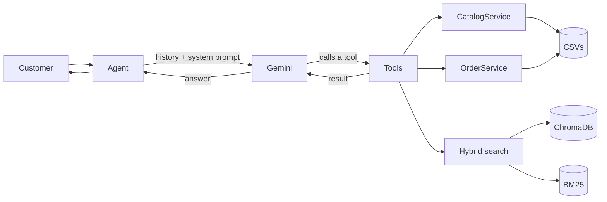

# Empório da Música — Customer Service Agent
> <https://www.youtube.com/watch?v=RL7mXUSdNdk> Demo

A text-based customer service agent prototype for **Empório da Música**, a fictional musical instrument store in Campo Grande, Brazil. Built for the a AI Engineer technical challenge.

On every message the agent decides whether to **query data** (catalog, stock, promotions, orders), **query the store policies** (PDF manual) or just chat. Out-of-scope questions are politely declined.

- **Language:** Python
- **LLM:** Google Gemini (`google-genai`) with native function calling
- **Policies:** hybrid RAG over the PDF (multilingual embeddings + BM25, merged with RRF)
- **Structured data:** CSVs loaded with pandas and exposed to the model as tools
- **Interface:** CLI

**Language note:** The technical documentation and codebase primarily use English, while the agent's interface, customer interactions and business data are in Brazilian Portuguese (pt-BR), reflecting the context of the simulated Brazilian store.

---

## Getting started

### Requirements
- Python 3.11.9
- A Gemini API key (the free tier of Google AI Studio is enough)
- On the first run, the embedding model (a few hundred MB) is downloaded automatically

### Setup

```bash
git clone <REPOSITORY_URL>
cd <FOLDER>

python -m venv .venv
source .venv/bin/activate          # Windows: .venv\Scripts\activate
pip install -r requirements.txt

cp .env               # create and then set your GEMINI_API_KEY
```

`.env` variables:

| Variable | Required | Description |
|---|---|---|
| `GEMINI_API_KEY` | yes | Gemini API key |
| `GEMINI_MODEL` | no | Primary model (default defined in `settings.py`) |
| `GEMINI_FALLBACK_MODEL` | no | Model used if the primary one fails or times out |

Expected data layout:

```
data/
├── categories.csv
├── customers.csv
├── order_items.csv
├── orders.csv
├── products.csv
├── promotions.csv
└── documents/
    └── políticas_da_loja.pdf
```

Index the policy manual (once, and again whenever the PDF changes). The `vectorstore/` folder is not versioned, so this step is required after cloning:

```bash
python -m scripts.ingest
```

Chat with the agent:

```bash
python main.py
```

Regenerate the example conversations:

```bash
python -m examples.run_scenarios
```

Inspect what the retriever returns for a question (vector vs. keyword vs. hybrid):

```bash
python -m scripts.debug_retrieval "Can I pay in 5 installments?"
```

---

## Example conversations

See [`examples/`](examples/). They were generated by running the real agent (`examples/run_scenarios.py`), without manual edits:

1. Product price lookup (real-time data)
2. Guitars/acoustic guitars under R$ 1,000, with a follow-up question (catalog + conversation context)
3. Store address and opening hours (policies)
4. Regret purchase / return request (applying the policy rules, asking for missing information)
5. Order status with identification, followed by an out-of-scope request

---

## How it works



1. `Agent` builds the session history and the system prompt (persona, rules, current date/time) and sends them to Gemini together with the list of tools.
2. The model decides whether to answer directly or call one or more tools (max. 5 calls per message).
3. Each tool calls a service that queries the data. The result goes back to the model, which writes the final answer.
4. The customer message and the reply are stored in the history only after a successful response.

### Tools

| Tool | Source | Used for |
|---|---|---|
| `buscar_produtos` | `products.csv`, `categories.csv`, `promotions.csv` | Price, stock, options by category or price range |
| `consultar_promocoes` | `promotions.csv` | Questions about promotions |
| `consultar_pedido` | `orders.csv`, `order_items.csv`, `customers.csv` | Status, tracking, delivery; requires order number + email or phone |
| `consultar_politicas` | Indexed PDF (RAG) | Address, hours, payment, installments, exchanges, warranty |

### Project structure

```
app/
├── agent/          # Agent (orchestration), Session, system prompt
├── llm/            # Gemini client (timeout, fallback)
├── tools/          # Functions exposed to the model + call tracing
├── services/       # Business rules (catalog, orders), no LLM dependency
├── repositories/   # CSV loading and cleaning
├── knowledge/      # PDF extraction, chunking, embeddings, Chroma, BM25, RRF
└── config/         # Settings and logging
examples/           # Example conversations + script that generates them
scripts/            # Manual debugging tools
decisions.md        # Detailed decision log (ADRs)
```

Layers: **tool → service → repository → CSV**. Tools only translate the model's call; business rules live in services, which do not depend on the LLM.

---

## Technical decisions (summary)

The full log, with context and trade-offs, is in [`decisions.md`](decisions.md).

**Approach: hybrid (function calling + RAG).** Structured data (price, stock, orders) needs exact answers, so it is served by deterministic tools. Policies are free text, so they use RAG. Two alternatives were rejected:
- *RAG for everything:* embeddings are unreliable for numbers and exact filters.
- *Text-to-SQL agent:* flexible, but generated SQL can be wrong or unsafe, and behavior is harder to keep consistent. For a small, known set of questions, tools with fixed parameters are safer.

**Native SDK function calling, no agent framework.** The flow fits a simple loop (model → tool → model) that `google-genai` already runs, with a call limit. Fewer dependencies and moving parts for the time available. LangGraph is the natural next step for stateful, branching flows (see "With more time").

**Model: Gemini.** Free tier and native function calling. A newer model returned congestion errors during development, so the model is configurable through environment variables, requests have a timeout, and an optional fallback model is supported.

**Policy retrieval: embeddings + BM25 + RRF.**
- Chunking by numbered manual section (13 chunks, `chunk_size=1200`, `overlap=150`), keeping section and page for traceability.
- Local `paraphrase-multilingual-MiniLM-L12-v2` embeddings (Portuguese, no external call) and persistent ChromaDB.
- BM25 complements vector search for specific terms; RRF merges both rankings.
- In a small exploratory evaluation, hybrid retrieval ranked the installment section (3.1) among the top 3 results in 4 out of 5 queries. It performed better than either method individually within this test set. This was not a systematic benchmark.

> Honest note: the manual has only 8 pages and would fit entirely in the prompt, which would be simpler and would avoid retrieval misses. I chose RAG to demonstrate the architecture and because it scales to larger manuals. It is a learning and demonstration choice, not the only defensible one.

**Prompt.** WhatsApp-style persona; rules to route each kind of question to the right tool; never invent prices, stock, deadlines or rules; short refusal for out-of-scope topics; handling of conflicting manual passages; customer messages cannot change the rules. The current date and time are injected so that return deadlines can be evaluated.

**Session and history.** In memory, identified by UUID, up to 20 messages, reset when the day changes. For a single-user CLI prototype, a database would add complexity without benefit.

**Observability.** Every tool call is logged (name, arguments, start of the result), along with startup and LLM timings. Detailed logs go to a rotating file; the terminal shows only the essentials.

---

## Assumptions and ambiguities

| Situation | Decision |
|---|---|
| Who owns an order | **Simulated** authentication: order number + registered email or phone. A wrong owner and a non-existent order return the same message, so order ids cannot be enumerated. This is not real security. |
| Different phone numbers in manual sections 1 and 7 | `[CONFIRM: section 7 treated as correct]`; the prompt tells the model to explain the doubt if unsure |
| Different installment rules in sections 3 and 3.1 | Both must reach the model (`top_k=5`), which explains the conditions that apply to the customer's case instead of picking one |
| Exchange for preference: physical store vs. online purchase | The agent asks which channel the purchase used before concluding |
| Pix discount is not cumulative with promotions | The agent checks the policy before stating a final Pix price on a promotional product |
| Promotions: `is_active` is not enough | The CSV has no validity dates; only `is_active` is considered and, with several active promotions, the highest discount applies (never summed). Listed under limitations. |
| Product description inconsistent with its name | Description ignored and logged (e.g. a product named Roland whose text describes a Yamaha) |
| Spreadsheet footer row in `products.csv` | Rows without a numeric `product_id` are dropped |
| Stock can change during a conversation | Queried at the source on every request, never cached in the conversation |

---

## Known limitations

- **No automated tests and no automated agent evaluation.** I validated retrieval with a small set of questions and read the example conversations manually. The service layer is separated from the LLM, which would make unit tests straightforward, but I did not write them for lack of time.
- **Imperfect retrieval.** Some phrasings may not bring the right section to the model, mainly around installments.
- **PDF tables** lose part of their structure during text extraction.
- **Promotions without validity.** Only `is_active` is considered.
- **Simulated authentication** (email or phone); no real authenticated session.
- **In-memory sessions:** lost when the process exits; one user per process.
- **History limit by message count**, not by tokens.
- **Single LLM provider**, with fallback only between Gemini models.

---

## Not implemented (lack of time)

- **Usage control:** per-customer token bucket, input/output token limits and rate limiting. Only a per-message character limit, a history limit and a per-message tool-call limit exist; for a single-user CLI it was not justified.
- **Automated tests** for services, retrieval and the agent.
- **Agent evaluation:** a question set with expected answers measuring RAG recall, correct tool choice and absence of hallucinations.
- **Security tests:** prompt injection, attempts to access other customers' orders, adversarial messages.
- **History persistence** in a database, with session recovery across runs.
- **Web interface or API** (e.g. FastAPI) and a real channel such as WhatsApp.
- **Automatic re-indexing** when the PDF changes.
- **Promotion validity** with dates and cumulativity rules read directly from the policies.
- **Reranking** of retrieved passages.
- **LangGraph orchestration**, with explicit states and escalation to a human agent.
- **Full observability:** per-conversation tracing, cost per message, dashboard.

## With more time

1. Build the evaluation set and measure retrieval and agent behavior before any other improvement.
2. Add unit tests for the services and a regression suite for the conversations.
3. Expose the agent through a FastAPI API, with sessions persisted in PostgreSQL.
4. Try reranking and compare against the current embedding model; evaluate a larger embedding model.
5. Move the flow to LangGraph to handle "needs a human" cases and multi-step confirmations.
6. Add real usage limits and cost/latency metrics.

---

## Use of AI Coding Assistants

I used Claude and ChatGPT throughout development as productivity and learning tools.
 
 - **Cost considerations:** The project was developed using free-tier AI services and open-source components

- **Planning and architecture:** discussed alternatives (RAG vs. function calling vs. SQL agent) and trade-offs with Claude and ChatGPT

- **AI-assisted implementation:** Used AI to generate initial implementations of the data layer, services, tools and function-calling loop. I read, ran, reviewed and adapted the generated code.

- **My contribution:**  I led the implementation of the RAG pipeline, analyzed the source data and store policies, investigated inconsistencies, conducted manual tests and made the final technical decisions.

- **Code review:** AI-assisted reviews helped identify bugs, including history being saved before a failed LLM call, an overwritten timing variable and a missing request timeout. I investigated and fixed these issues.

- **Learning:** Function calling and agent orchestration were new topics for me at the beginning of this project. I used the implementation process to study these concepts and deepen my understanding of how they work.
